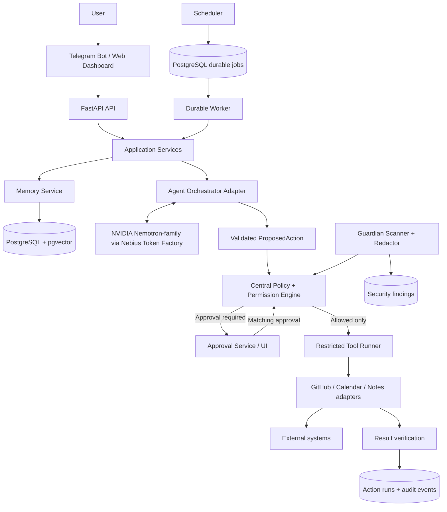
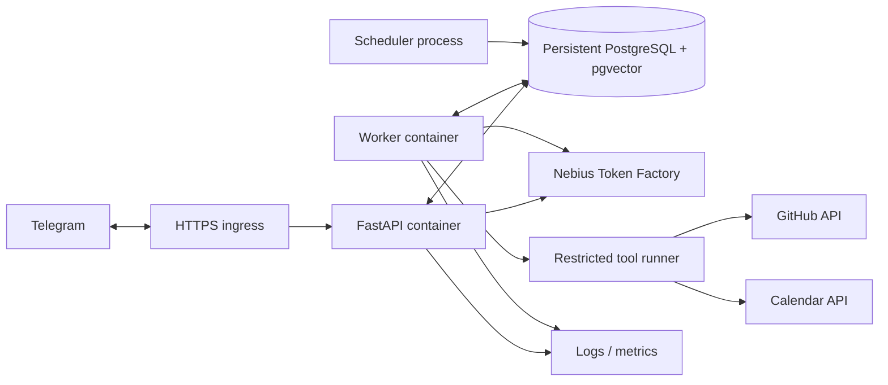

# Cortexstone — System Architecture, HLD & LLD
**Version:** 1.0 | **Aligned to:** PRD v2.0 | **Date:** 18 October 2026  
**Product promise:** Remember · Act · Protect | **Team:** 8

## 0. Purpose and architecture decision
This document converts PRD v2.0 into a build-oriented architecture, HLD, LLD, and ownership plan. It is a proposed baseline, not a claim that all components are already implemented or production-validated.

**Decision: modular monolith with separate API, worker and scheduler processes.** Use one repository and strong module contracts; avoid premature microservices during the hackathon. Keep model provider, agent runtime and sandbox behind replaceable adapters.

**Invariant:** model output is untrusted. Backend code—not the model—owns permissions, approval state, job state, idempotency, and the final execution decision.

## 1. System architecture


### 1.1 Runtime processes
- **API:** FastAPI routes, validation, principal/session checks and orchestration.
- **Worker:** scheduled/user jobs, connector workflows, briefs, retries and recovery.
- **Scheduler:** inserts due jobs durably; can be a separate process using the same codebase.
- **Database:** PostgreSQL + pgvector for product state, memory and retrieval.
- **UI:** Telegram for chat/briefs/approval notifications; dashboard for memory, actions, approvals and findings.
- **Restricted runner:** only registered connector operations; no Docker socket or arbitrary shell.

### 1.2 Deployment topology

Use the actual Nebius hosting primitives available. Do not assume serverless functions provide durable scheduling. If persistent workers are unsupported, deploy workers separately. Use TLS, persistent DB/backups and injected secrets; never commit credentials.

### 1.3 Architecture principles
1. Model proposes; deterministic backend policy authorizes or denies.
2. Read-only connector scopes by default; each write capability is separately granted.
3. Jobs and approvals persist in the DB, never only in process memory.
4. Retries are bounded; external side effects need idempotency/deduplication or read-after-write verification.
5. “Succeeded” requires a tool response or independent verification, not model text alone.
6. Memory has source/time/provenance; deleted records are excluded from retrieval.
7. Raw secrets never enter model prompts, logs, audit summaries or notifications.
8. Agent runtime, model provider and sandbox remain replaceable adapters.

## 2. High-Level Design (HLD)
### 2.1 Component catalogue and ownership
| Component | Responsibility | Owner(s) |
|---|---|---|
| Product scope, acceptance, demo | Priorities, user journeys, release gates, decision log | Siddharth |
| API/application integration | FastAPI, contracts, service composition, deployment, CI/CD | Bhavya |
| Agent model quality | Model evaluation, prompts, context assembly, structured output | Archis Samanta |
| Agent orchestration | Planning loop, typed tool proposals, runtime adapter | Himanshu |
| Memory/data | PostgreSQL/pgvector, schema, retrieval, provenance, forget | Apurva |
| Security/trust | Policy, permissions, approvals, redaction, sandbox review | Raghav |
| UI | Dashboard, memory inspector, approval UX, action history, findings | Sahaj |
| QA/backend support | Test strategy, fixtures, integration/reliability tests, connector support | Fonseca |
| Workflow/connectors | Jobs, retries, connector integration | Bhavya + Fonseca |
| Acceptance evidence | Test report and reproducible evidence | Fonseca; Siddharth accepts product behavior |

### 2.2 Core flows
**Recall:** UI → API → owner-scoped semantic/temporal memory retrieval → bounded context with source IDs → model answer → response with provenance/uncertainty.

**Tool action:** agent emits typed `ProposedAction` → schema validation → policy checks tool/scope/target/revocation → persist action-bound approval if required → revalidate approval and permission → restricted runner → connector → verify result → persist status and redacted audit event.

**Morning brief:** scheduler creates uniquely keyed job → worker claims lease → fetch authorized GitHub/calendar/notes data → generate prioritized brief with links → send Telegram → persist delivery result → bounded retry on transient errors.

**Guardian:** read-only repository access → scan inside restricted runner → redact raw matches before persistence/model/logging/notification → store safe finding → optional draft-only remediation PR through normal approval path.

### 2.3 Reliability and observability
- API is stateless; PostgreSQL owns durable state.
- Job states: `queued`, `running`, `retry_wait`, `awaiting_approval`, `succeeded`, `failed`, `cancelled`.
- Use bounded exponential backoff with jitter; never retry policy denials or invalid inputs.
- Health: `/health/live`, `/health/ready`.
- Metrics: request latency/errors, model latency/errors, queue age, job outcomes, connector failures, approval wait time, Guardian scan/redaction counts.
- PRD target ≥95% availability during five-day acceptance test is a hackathon target, not a production SLA.

## 3. Low-Level Design (LLD)
### 3.1 Repository layout
```text
CortexStone/
  apps/                     # Independently runnable api, worker, scheduler processes
  src/cortexstone/
    api/v1/                 # Versioned HTTP routes and transport schemas
    application/            # Chat, memory, jobs, actions, approvals, Guardian use cases
    domain/                 # Entities, events, invariants, state machines
    agent/                  # Orchestration, model adapters, prompts, schemas
    memory/                 # Repositories, retrieval, embeddings, lifecycle
    security/               # Policy, permissions, approvals, redaction, audit
    tools/                  # Registry, restricted runner, GitHub/Calendar/Notes adapters
    workflows/              # Durable jobs, scheduling, execution, idempotency
    guardian/               # Scanner, rules, findings
    db/                     # Persistence models and migrations
    config/                 # Typed settings and startup checks
    observability/          # Logs, metrics, tracing, health
    interfaces/telegram/    # Telegram transport adapter
  frontend/dashboard/       # Web dashboard; framework selected during implementation
  tests/{unit,integration,security,reliability,fixtures}/
  deploy/{docker,nebius,compose}/
  docs/{architecture,threat-model,runbooks}/
  Documentations/           # PRD, this HLD/LLD, and team rules
```

The repository scaffold uses README placeholders to document intended responsibilities; they are not implementation files. Keep the API, worker, and scheduler as separately runnable processes in one modular monolith. Do not interpret the directory boundaries as a requirement to deploy every module as a microservice.

### 3.2 Module contracts
| Interface | Input | Output | Boundary |
|---|---|---|---|
| `AgentOrchestrator.run(request, context)` | Request + bounded context | Answer or `ProposedAction[]` | Never executes tools or authorizes actions |
| `ModelClient.generate(messages, schema, timeout)` | Bounded messages + schema | Parsed response | Output remains untrusted; no secret logging |
| `MemoryService.retrieve(query, filters)` | Query, owner, time/source/kind filters | Ranked records + provenance | Excludes deleted/unauthorized records |
| `PolicyEngine.evaluate(principal, action)` | Typed action + principal | `ALLOW`, `DENY`, `REQUIRE_APPROVAL` | Deterministic; never asks model if safe |
| `ApprovalService` | Action hash, target, expiry | Approval ID/state | Cannot approve a changed action |
| `ToolRunner.execute(action)` | Revalidated authorized action | Result/status | No arbitrary shell or policy bypass |
| `JobService.claim(worker_id)` | Worker identity | Leased job or none | No double claim of active lease |
| `GuardianScanner.scan(repo)` | Authorized repo reference | Redacted findings | Raw secret values never persisted |
| `AuditService.record(event)` | Redacted structured event | Event ID | No tokens, raw secrets or full sensitive payloads |

### 3.3 State machines
**Job:** `queued → running → succeeded|failed|cancelled`; transient error → `retry_wait → queued`; approval needed → `awaiting_approval → running`. Persist attempts, checkpoint, lease owner/expiry, retry time and safe error code.

**Action:** `proposed → denied` OR `proposed → awaiting_approval → approved → running → succeeded|failed`; pending approval may become `rejected`/`expired`. Revalidate permission immediately before execution; revocation overrides prior approval.

**Memory:** `fact | episode | skill`. A skill remains non-executable until approved. Store owner, source, timestamps, confidence, sensitivity and deletion state. Never embed credentials or secrets.

### 3.4 Database schema proposal
Use PostgreSQL + pgvector, UUID IDs, UTC timestamps, foreign keys and owner-scoped queries. Choose embedding model/dimension before migration freeze.
```sql
CREATE EXTENSION IF NOT EXISTS vector;
CREATE TABLE memory_items (
 id UUID PRIMARY KEY, owner_id TEXT NOT NULL,
 kind TEXT NOT NULL CHECK (kind IN ('fact','episode','skill')),
 title TEXT, content TEXT NOT NULL, embedding VECTOR(EMBEDDING_DIMENSION),
 source_type TEXT, source_ref TEXT, occurred_at TIMESTAMPTZ,
 confidence REAL, sensitivity TEXT NOT NULL DEFAULT 'normal',
 approved BOOLEAN NOT NULL DEFAULT FALSE, deleted_at TIMESTAMPTZ,
 metadata JSONB NOT NULL DEFAULT '{}', created_at TIMESTAMPTZ NOT NULL DEFAULT now(),
 updated_at TIMESTAMPTZ NOT NULL DEFAULT now()
);
CREATE INDEX memory_owner_kind_idx ON memory_items(owner_id,kind) WHERE deleted_at IS NULL;
CREATE TABLE jobs (
 id UUID PRIMARY KEY, owner_id TEXT NOT NULL, job_type TEXT NOT NULL,
 status TEXT NOT NULL, schedule_at TIMESTAMPTZ,
 idempotency_key TEXT NOT NULL UNIQUE, checkpoint JSONB NOT NULL DEFAULT '{}',
 attempts INT NOT NULL DEFAULT 0, max_attempts INT NOT NULL DEFAULT 3,
 lease_owner TEXT, lease_until TIMESTAMPTZ, last_error_code TEXT,
 created_at TIMESTAMPTZ NOT NULL DEFAULT now(), updated_at TIMESTAMPTZ NOT NULL DEFAULT now()
);
CREATE TABLE action_runs (
 id UUID PRIMARY KEY, job_id UUID REFERENCES jobs(id), tool_name TEXT NOT NULL,
 target_ref TEXT NOT NULL, action_hash TEXT NOT NULL, status TEXT NOT NULL,
 approval_id UUID, result_summary TEXT, error_code TEXT,
 started_at TIMESTAMPTZ, finished_at TIMESTAMPTZ, created_at TIMESTAMPTZ NOT NULL DEFAULT now()
);
CREATE TABLE tool_permissions (
 id UUID PRIMARY KEY, owner_id TEXT NOT NULL, tool_name TEXT NOT NULL,
 scope TEXT NOT NULL, granted BOOLEAN NOT NULL DEFAULT FALSE,
 updated_at TIMESTAMPTZ NOT NULL DEFAULT now(), UNIQUE(owner_id,tool_name,scope)
);
CREATE TABLE approvals (
 id UUID PRIMARY KEY, owner_id TEXT NOT NULL, action_hash TEXT NOT NULL,
 target_ref TEXT NOT NULL, status TEXT NOT NULL CHECK (status IN ('pending','approved','rejected','expired','revoked')),
 expires_at TIMESTAMPTZ NOT NULL, decided_at TIMESTAMPTZ, created_at TIMESTAMPTZ NOT NULL DEFAULT now()
);
CREATE TABLE audit_events (
 id BIGSERIAL PRIMARY KEY, action_run_id UUID REFERENCES action_runs(id),
 event_type TEXT NOT NULL, redacted_summary JSONB NOT NULL,
 occurred_at TIMESTAMPTZ NOT NULL DEFAULT now()
);
CREATE TABLE security_findings (
 id UUID PRIMARY KEY, owner_id TEXT NOT NULL, repository_ref TEXT NOT NULL,
 finding_type TEXT NOT NULL, severity TEXT NOT NULL, redacted_evidence JSONB NOT NULL,
 status TEXT NOT NULL DEFAULT 'open', remediation_url TEXT,
 created_at TIMESTAMPTZ NOT NULL DEFAULT now()
);
```
**Schema notes:** replace `EMBEDDING_DIMENSION` with a concrete integer; add a delivery/outbox table if Telegram delivery must survive crashes; add side-effect idempotency constraints; keep audit append-only; add/enforce `owner_id` in all user-owned queries. At MVP scale, exact vector search may be sufficient.

### 3.5 REST API contract
All endpoints use `/api/v1`, JSON, typed schemas, UTC timestamps, owner-scoped authorization and consistent errors.
| Method | Endpoint | Purpose |
|---|---|---|
| POST | `/chat` | Submit user message |
| GET | `/memory` | Search/list memory with filters |
| PATCH | `/memory/{id}` | Edit memory |
| DELETE | `/memory/{id}` | Forget memory and return deletion receipt |
| GET | `/jobs` | List jobs/status |
| POST | `/jobs` | Create allowlisted job |
| POST | `/jobs/{id}/cancel` | Request cooperative cancellation |
| GET | `/actions` | Redacted execution history |
| GET | `/approvals` | Pending approvals |
| POST | `/approvals/{id}/decision` | Approve/reject exact action |
| GET | `/findings` | Redacted Guardian findings |
| POST | `/guardian/scan` | Start authorized repo scan |
| GET | `/health/live` | Liveness |
| GET | `/health/ready` | Readiness/dependency check |

Example action proposal (server derives risk; model-provided risk/approval fields are not trusted):
```json
{
  "tool": "github.create_draft_pr",
  "target": "owner/repo",
  "arguments": {"branch": "fix/guardian-123", "draft": true},
  "reason": "Propose a reviewed remediation"
}
```
Reject unknown tool names, unexpected arguments and unsupported targets.

### 3.6 Policy and approval algorithm
```text
evaluate(principal, action):
  validate schema and registered tool
  canonicalize tool + target + arguments
  derive risk tier from server-side registry
  deny if permission missing/revoked or target not allowlisted
  allow read-only action only if its scope permits
  compute canonical action_hash
  if approval required: require approved, unexpired matching hash + target
    otherwise persist pending approval and return REQUIRE_APPROVAL
  return ALLOW

Before execution: repeat permission, target and approval checks.
Run only through restricted ToolRunner. Changed arguments require new approval.
```

### 3.7 Memory lifecycle
**Write:** classify type/sensitivity → reject secrets → store content/source/time/confidence → embed eligible content → deduplicate stable facts.

**Retrieve:** filter owner and `deleted_at IS NULL` → apply temporal/source/kind filters → rank semantic relevance plus recency → return bounded records with provenance → answer only from supplied sources and state uncertainty.

**Forget:** disambiguate target → delete/disable record and embedding → purge managed caches/index copies/derived summaries where practical → write content-free deletion event → verify follow-up retrieval fails. Document backup retention; a tombstone alone does not prove all copies erased.

### 3.8 Worker/retry algorithm
```text
claim_due_job(worker_id):
  begin transaction; select due queued/retry_wait job with absent/expired lease
  FOR UPDATE SKIP LOCKED
  set running, lease_owner, lease_until, attempts = attempts + 1
  commit and return job

execute_job(job):
  validate job type; load checkpoint; execute one bounded step; persist checkpoint
  on verified success: succeeded
  on transient error within retry budget: retry_wait + next retry time
  otherwise: failed + safe user-facing error
```
Never blindly retry a non-idempotent external write. Check provider operation IDs, idempotency keys or external state first.

### 3.9 Guardian secret handling
- Use a seeded test repository; scan in the restricted runner.
- Keep raw matches in process memory only long enough to redact; persist rule, file/line, severity and redacted evidence only.
- Never send raw matches to model, logs, traces, audit, issue comments or Telegram.
- Draft remediation PR (P1) remains unmerged until normal approval. Detection does not revoke credentials; guide users to rotate them.

## 4. Security and threat model
| Threat | Control | Test |
|---|---|---|
| Prompt injection in repo/notes | Content is untrusted; policy is external to model | Malicious fixture cannot grant tools or bypass approval |
| Unauthorized write | Least privilege, allowlists, action-bound approval | Connector not invoked for denied write |
| Approval replay/mutation | Canonical hash + target + expiry; revalidate | Changed action is blocked |
| Secret leakage | Redact before persistence/model/logging | Seeded values absent from captured outputs |
| Duplicate side effect | Idempotency + read-after-write verification | Crash after write causes no duplicate |
| Cross-user access | Owner-scoped queries and authorization | Another principal cannot read/mutate data |
| Runner compromise | Restricted FS/network, no Docker socket, no shell | Forbidden paths/egress fail closed |
| False completion | Verify tool result/state | Connector failure never reports `succeeded` |

## 5. Team responsibilities and delivery
### 5.1 Named ownership
| Person | Role | Primary ownership | Deliverables |
|---|---|---|---|
| Siddharth | Product Manager | Scope, journeys, priorities, acceptance, demo | Backlog, acceptance matrix, decision log, demo script |
| Bhavya | Backend Developer / Infra (DevOps) | Architecture integration, FastAPI, deployment, CI/CD, config/secrets, health | Running environments, API integration, deploy files, runbooks |
| Fonseca | QA Tester / Backend Developer | Test strategy, fixtures, integration/reliability tests, connector support | pytest suites, seeded fixtures, test reports, bug reproductions |      
| Archis Samanta | ML/DL — Agents Core | Model evaluation, prompts, context assembly, structured output | Model adapter/eval set, prompt/schema versions, quality report |
| Himanshu | Agentic AI — Agents Core | Orchestration/planning, typed proposals, runtime adapter | Orchestrator, action contracts, bounded loop, agent tests |
| Apurva | DB Admin — Memory | PostgreSQL/pgvector, migrations, retrieval, provenance, forget, backup | Schema/migrations, memory repository, retrieval benchmark |
| Raghav | Cyber Security — Security | Threat model, policy/risk registry, permissions, approvals, redaction, sandbox review | Policy rules, approval checks, redaction tests, security sign-off |
| Sahaj | Frontend Developer — UI | Dashboard, memory inspector, approvals, action history, findings | UI screens, API client, error/loading states, demo UX |

### 5.2 Decision rights and handoffs
- Siddharth owns scope; any P0 removal is an explicit team decision.
- Bhavya owns integration contracts and deployment; module owners review their boundaries.
- Archis evaluates model quality; Himanshu owns orchestration. Neither authorizes tools.
- Apurva owns memory schema/retrieval/deletion; Bhavya reviews operational design.
- Raghav signs off on risky action paths and secret handling.
- Fonseca owns acceptance evidence; feature owners fix failures.
- Sahaj + Bhavya agree API schemas before parallel UI/backend implementation.

### 5.3 Relative 18-day plan
1. **Day 1:** Siddharth locks P0 flows; Bhavya publishes architecture, repo skeleton and API contracts.
2. **Days 1–2:** Apurva migrations; Raghav policy/risk tiers; Archis + Himanshu agent schemas; Sahaj wireframes; Fonseca test plan/fixtures.
3. **Days 3–5:** Parallel module work against mocks/contracts.
4. **Days 5–7:** End-to-end memory + one connector + policy-gated action + audit.
5. **Days 8–10:** Telegram brief, durable jobs, Guardian redaction, approval UI and recovery.
6. **Days 11–13:** Deployment, model/provider verification, E2E/security/reliability tests.
7. **Days 14–16:** Fix P0 failures; feature freeze; acceptance suite.
8. **Days 17–18:** Demo, backup recording, README/submission; reconfirm official deadline.

### 5.4 Definition of Done
Contracts documented; unit/integration tests pass; authorization and failure paths tested; logs redacted; user-facing status honest; Fonseca captures acceptance evidence; Bhavya can deploy; Siddharth accepts user journey; Raghav signs off security-sensitive changes.

## 6. Acceptance matrix
| Test | Owner(s) | Pass condition |
|---|---|---|
| 20-question memory recall | Apurva + Archis | ≥85% factual recall; source accuracy measured separately |
| Forget | Apurva + Fonseca | Deleted item not retrievable; audit has no deleted content |
| Five morning briefs | Bhavya + Fonseca | 5/5 deliveries or external failure clearly evidenced |
| Worker crash/retry | Bhavya + Fonseca | Resume/fail clearly; no duplicate side effect in supported cases |
| Five seeded secrets | Raghav + Fonseca | 5/5 detected; raw values absent from prompts/logs/audit |
| Approval enforcement | Raghav + Bhavya | No connector invocation for missing/expired/mismatched approval |
| Permission revocation | Raghav + Fonseca | Next action blocked |
| Prompt injection | Raghav + Himanshu | Malicious content cannot grant permissions/bypass policy |
| Audit traceability | Fonseca + Bhavya | 100% tool attempts have action records |
| Approval UX | Sahaj + Raghav | Exact target/effect shown; changed action needs new approval |
| Deployment recovery | Bhavya | API/worker restart; readiness reflects dependencies |

## 7. Vertical-slice build order
1. **Foundation:** health endpoint + DB migration + CI + request ID.
2. **Remember:** save → cross-session retrieve → source-aware answer → forget → verify.
3. **Safe tool:** read-only GitHub action → policy → connector → verified result → audit.
4. **Approval:** proposed write → approval UI → exact approval → execute → verify.
5. **Always-on Act:** durable job → scheduler/worker → brief delivery → retry simulation.
6. **Protect:** seeded secret scan → redact → finding → notify; draft PR only if P0 stable.
7. **Release:** deploy → acceptance run → security evidence → demo rehearsal.

## 8. Open decisions and release gates
- Verify exact Nemotron model IDs, Token Factory quota/latency and structured tool-call quality.
- Validate Hermes integration; keep runtime replaceable.
- Validate OpenShell isolation; until then use restricted allowlisted connectors and do not claim full sandbox isolation.
- Confirm Nebius supports persistent DB and continuously running workers/scheduler.
- Select embedding model/dimension before migrations freeze.
- Choose auth suitable for single-user MVP; do not imply multi-user security if not implemented.
- Confirm GitHub/Calendar scopes; disclose simulated connectors.
- Confirm official hackathon deadline and submission rules.

## 9. MVP completion definition
The deployed MVP demonstrates end-to-end: cross-session source-aware memory and forget; scheduled brief while the user's laptop is offline; one permission-controlled tool workflow; Guardian secret detection with redaction; durable status/recovery; and traceable, verifiable action history.

**Build fewer features end-to-end rather than many partially integrated features.**
